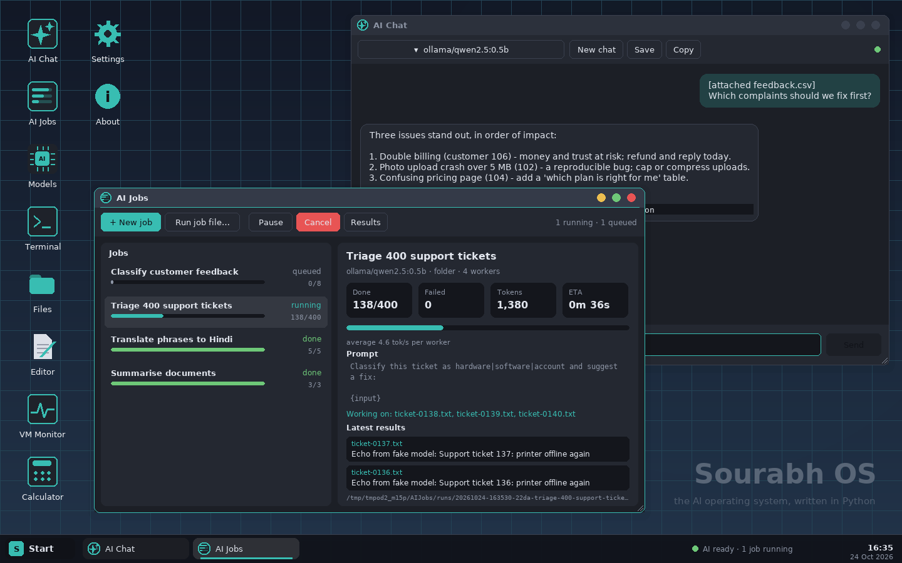

# Sourabh OS

**The AI operating system, written in Python.**

Boot it in a virtual machine (or on a real PC) and you land on a full desktop built for AI work — chat with models, process thousands of files with AI in parallel, manage local models, and script everything from a terminal. A tiny teaching kernel is baked in so you can also see how a real OS works.



---

## What Is This?

> Imagine you could buy a computer that, right when it turns on, already knows how to talk to AI. No setup, no installing Python, no figuring out API keys — it just works. That's Sourabh OS.

Normally when you want to use an AI model (like ChatGPT or a local Llama model) you have to:
1. Install Python
2. Install libraries
3. Figure out API keys
4. Write code

Sourabh OS skips all of that. It's a **whole operating system** (like Windows or macOS) that boots straight into a desktop made for AI. The AI tools are just… there, ready to go.

It's built entirely in **Python** on top of a minimal Linux base (Debian supplies the kernel; Python supplies everything you see and interact with).

---

## What It Can Do

| Feature | Plain-English Explanation |
|---|---|
| **AI Chat** | A chat window (like ChatGPT) that works with local offline models *or* Claude/OpenAI keys. Press `Ctrl+Alt+Space` anywhere to open it. |
| **AI Jobs** | "Run this prompt on every file in this folder." You give it a template and a pile of inputs (files, CSV rows, lines of text), and it runs AI on all of them in parallel — even while you do other things. |
| **Models** | Download/delete local AI models, add API keys, and see how much RAM/CPU/GPU you have and which model sizes will actually fit. |
| **`sourabh-ai` CLI** | A command-line tool for scripts, cron jobs, and SSH access. Run AI from anywhere. |
| **Chrome** | Google Chrome is included — open the browser from the desktop for research. |
| **TinyVM** | A mini teaching computer-inside-a-computer. Run tiny assembly programs and watch memory pages, the scheduler, and registers in real time. Great for learning how OSes work. |

---

## How It Fits Together

```
┌──────────────────────────── Sourabh OS (Python) ────────────────────────────┐
│                                                                               │
│  Desktop (sourabhos/desktop/)                                                 │
│  ┌────────────────────────────────────────────────────────────────────────┐  │
│  │  Window manager · Taskbar · Start menu · Themes                        │  │
│  │  Apps: AI Chat · AI Jobs · Models · Terminal · Files · Editor · Chrome │  │
│  └────────────────────────────────────────────────────────────────────────┘  │
│                                                                               │
│  AI Layer (sourabhos/ai/)                                                     │
│  ┌──────────────────────────────────────────────────────────────────┐        │
│  │  providers.py  →  talks to Ollama / Anthropic / OpenAI APIs      │        │
│  │  jobs.py       →  batch job engine: queue, workers, retries      │        │
│  │  hardware.py   →  reads your CPU / RAM / GPU stats               │        │
│  │  cli.py        →  the sourabh-ai command-line tool               │        │
│  └──────────────────────────────────────────────────────────────────┘        │
│                                                                               │
│  Teaching Kernel (sourabhos/core/)                                            │
│  ┌──────────────────────────────────────────────────────────────────┐        │
│  │  vm.py  →  TinyVM: assembler, CPU (10 registers), paging,        │        │
│  │             scheduler, locks, events, shared memory               │        │
│  └──────────────────────────────────────────────────────────────────┘        │
│                                                                               │
│  System glue (sourabhos/system.py)                                            │
│  └──  settings, home folder, wires the VM + AI layer + desktop together      │
│                                                                               │
└───────────────────────────────────────────────────────────────────────────────┘
     ↑ all of the above is Python + pygame (drawing the screen)
     ↑ running on top of a minimal Debian Linux (kernel + drivers only)
     ↑ packaged into one bootable ISO by iso/build.sh
```

**Why Linux underneath?** Python can't talk to hardware (graphics cards, USB, network) on its own. A tiny Debian base provides the kernel and drivers. Nothing else from Debian is visible to you — the machine boots straight into the Python desktop, full screen.

---

## Project Layout

```
sourabh-os/
├── sourabhos/              ← the main Python package
│   ├── main.py             ← entry point: boot splash → desktop main loop
│   ├── system.py           ← System class: wires everything together
│   ├── ai/
│   │   ├── providers.py    ← Ollama, Anthropic, OpenAI — one unified interface
│   │   ├── jobs.py         ← batch AI job engine (queue, workers, retries, resume)
│   │   ├── hardware.py     ← CPU / RAM / GPU detection + "what model fits?" advice
│   │   └── cli.py          ← sourabh-ai command (ask, models, pull, run, submit, jobs)
│   ├── core/
│   │   └── vm.py           ← TinyVM: assembler + CPU + memory manager + scheduler
│   └── desktop/
│       ├── wm.py           ← window manager (windows, taskbar, start menu)
│       ├── ui.py           ← low-level UI widgets (buttons, text, scroll, etc.)
│       ├── theme.py        ← colours, fonts, icons; Plymouth boot logo generator
│       └── apps/           ← every app: AI Chat, AI Jobs, Models, Terminal, …
├── programs/               ← sample TinyVM assembly programs (.tvm files)
├── ai-examples/            ← example batch AI job files + sample input data
├── iso/                    ← scripts that build the bootable ISO
│   ├── build.sh            ← builds the ISO on Debian/Ubuntu directly
│   ├── build-in-docker.sh  ← builds the ISO inside Docker (Linux/macOS)
│   ├── build-in-docker.ps1 ← same, for Windows + Docker Desktop
│   └── create-hyperv-vm.ps1← creates a Hyper-V VM from the ISO automatically
├── tests/
│   ├── test_ai.py          ← AI layer tests (uses a fake AI server)
│   ├── test_vm.py          ← TinyVM kernel tests
│   └── test_desktop.py     ← desktop/UI tests (headless via SDL_VIDEODRIVER=dummy)
├── docs/                   ← screenshots used in this README
├── requirements.txt        ← Python deps (just pygame + stdlib)
├── run.sh / run.bat        ← convenience scripts to launch on your PC
└── LICENSE
```

---

## Walkthrough: What Happens When It Boots

1. **`python3 -m sourabhos.main`** is run (either by you or by the OS image on startup).
2. **`main.py`** sets up pygame (the graphics library), creates the `System` object, and shows a **boot splash** screen with a spinning arc and progress bar.
3. **`system.py` (`System.__init__`)** wires everything together:
   - Creates `~/SourabhHome/` with `Documents/`, `Programs/`, `.config/`, `AIJobs/` on first run.
   - Copies example TinyVM programs and AI job examples into place.
   - Loads `settings.json` (theme, VM speed, AI keys, etc.).
   - Starts **TinyVM** (the teaching kernel) — it's always running in the background.
   - Starts the **AI service** and a background thread that checks whether Ollama is running.
   - Starts the **Job Manager** which watches `~/SourabhHome/AIJobs/` for new/queued jobs.
   - Starts the **Hardware monitor** (reads CPU, RAM, GPU info in a background thread).
4. **`Desktop`** (`wm.py`) takes over: draws the taskbar, handles windows, routes keyboard/mouse events.
5. The **60 FPS main loop** runs:
   - Processes pygame events (mouse clicks, keyboard, window resize).
   - Calls `system.tick(dt)` — this runs a slice of TinyVM instructions and rescans for new jobs.
   - Updates every open app window.
   - Draws the frame and flips the display.

---

## The AI Layer (`sourabhos/ai/`)

### `providers.py` — Talking to AI Models

> This file is like a universal translator. Whether you're talking to a local Ollama model, Claude, or ChatGPT, this file makes it look the same to the rest of the code.

A model is always referred to as `"provider/model-name"`:
- `"ollama/qwen2.5:0.5b"` → local model running on your machine
- `"anthropic/claude-haiku-5-5"` → Anthropic's API
- `"openai/gpt-4o-mini"` → OpenAI's API (or any compatible server like vLLM, LM Studio)

All three implement the same interface: `chat(messages, stream=True, ...)`. The rest of the codebase never needs to know which provider it's talking to.

**Streaming** works by reading Server-Sent Events (SSE) from the HTTP response line by line — no third-party AI library needed, just Python's built-in `urllib`.

### `jobs.py` — Batch AI Job Engine

> Imagine you have 500 customer reviews and you want AI to classify each one as positive, negative, or neutral. You don't want to do them one at a time. AI Jobs lets you say "do all 500, use 4 workers at once, retry any that fail, and save the results."

A **job** is a JSON file that describes:
- **What to do** — a system prompt + a prompt template with `{input}` placeholder
- **What to run it on** — a folder of files, a CSV, a text file of lines, or an inline list
- **How to run it** — which model, how many parallel workers, how many retries

The engine works like this:

```
Job file (JSON)
     ↓
load_items() — expands the input source into a list of {name, input, vars} dicts
     ↓
JobRun object — one per execution; stores state in a run folder on disk
     ↓
ThreadPoolExecutor — runs `concurrency` workers in parallel
     ↓
Each worker calls ai.chat() for one item → writes output to outputs/<name>.md
     ↓
Progress saved to run/state.json after every item → survives reboots
     ↓
Final: results.jsonl + results.csv written when all items complete
```

States a job can be in: `queued → running → paused / done / failed / cancelled`

**Resume after reboot:** The state file (`state.json`) records which items are done. On restart, the engine reads it and skips finished items — you never redo work.

### `hardware.py` — System Info + "What Fits?"

Reads `/proc/cpuinfo`, `/proc/meminfo`, and (optionally) `nvidia-smi` in a background thread. Computes how much RAM is free and advises which model sizes will fit: 0.5–1B models need ~2 GB, 3B need ~4 GB, 7–8B need ~8 GB.

### `cli.py` — `sourabh-ai` Command

```
sourabh-ai ask "What is RAID 5?"                     # one-shot question
sourabh-ai ask -m anthropic/claude-haiku-5-5 "..."   # use a specific model
cat report.txt | sourabh-ai ask "Summarise:" -       # pipe input
sourabh-ai models                                    # list available models
sourabh-ai pull llama3.2:3b                          # download a local model
sourabh-ai run job.json                              # run a batch job, show progress
sourabh-ai submit job.json                           # queue for desktop to pick up
sourabh-ai jobs                                      # list job runs
```

---

## The Teaching Kernel (`sourabhos/core/vm.py`)

> Inside Sourabh OS there's a tiny pretend-computer. You can write little programs for it in assembly language (very low-level code close to what a real CPU understands) and then watch it run them — see exactly how memory gets allocated, how the CPU switches between programs, everything.

TinyVM is a Python re-implementation of Scott Hanselman's [TinyOS](https://github.com/shanselman/TinyOS). It has:

| Part | What it does |
|---|---|
| **Assembler** | Reads `.tvm` text files and turns them into byte code (1 byte opcode + 4 bytes per parameter) |
| **CPU** | 10 registers (r0–r9), an instruction pointer, a stack pointer, a flags register |
| **Memory manager** | Virtual memory with demand paging: each process has its own address space; pages are swapped in/out as needed |
| **Scheduler** | Priority round-robin: processes take turns; higher-priority processes get more turns |
| **Synchronisation** | 10 global locks + 10 global events; `acquirelock`/`releaselock`, `signalevent`/`waitevent` |
| **Shared memory** | Processes can map the same region above `0x8000` to communicate |

**36 opcodes:**

```
Move data:    movi, movr, movmr, movrm, movmm, pushr, pushi, popr, popm
Math:         incr, addi, addr
Jumps:        jmp, jlt, jgt, je, call, callm, ret
Compare:      cmpi, cmpr
I/O:          printr, printm, input
Memory:       alloc, freememory, memoryclear, mapsharedmem
Sync:         acquirelock, releaselock, signalevent, waitevent, sleep
Process:      setpriority, exit, terminateprocess
```

### Writing a TinyVM Program

One instruction per line. `;` starts a comment. Use register names (`r0`–`r9`) or numeric opcode:

```asm
; hello.tvm — count from 1 to 5
movi    r1, $1         ; r1 = 1  (the counter)
movi    r3, $-24       ; r3 = jump offset back 24 bytes (to the printr below)
printr  r1             ; print r1
incr    r1             ; r1 = r1 + 1
cmpi    r1, $6         ; set flags: is r1 < 6?
jlt     r3             ; if yes, jump back
exit                   ; done
```

Run it: `run hello.tvm` in the Terminal, or double-click it in Files.

Included examples:
- `hello.tvm` — counts 1–5
- `fib.tvm` — Fibonacci sequence
- `producer.tvm` + `consumer.tvm` — shared memory + locks + events (two cooperating processes)
- `memhog.tvm` — allocates lots of memory to demonstrate paging
- `countdown.tvm` — uses `sleep`
- `echo.tvm` — reads user input
- `fault.tvm` — deliberately causes a memory protection fault
- `idle.tvm` — does nothing (background process)

---

## The Desktop (`sourabhos/desktop/`)

### `wm.py` — Window Manager

> This is the code that draws windows on screen and lets you move/resize/close them with your mouse — like a very simple version of Windows' window manager.

`Desktop` manages a list of `Window` objects. Each `Window` wraps an `App`. The window manager:
- Draws the desktop background
- Draws each window (title bar, close button, resize handles)
- Routes mouse/keyboard events to the focused window
- Draws the taskbar at the bottom (running apps + clock)
- Draws the Start menu when you click Start

### `theme.py` — Colours, Fonts, Icons

All colours live in a `C` dict keyed by role (`"accent"`, `"bg"`, `"text"`, `"dim"`, …). Three built-in themes: **Midnight** (dark blue), **Dusk** (warm dark), **Dawn** (light). Change theme in Settings.

Icons are drawn procedurally with pygame primitives — no image files needed.

`make_branding.py` generates the Plymouth boot logo (the animation before the desktop appears) from the same theme colours. Run it after changing `theme.py`.

### `apps/` — All the Applications

Every app is a Python class that subclasses `App`. Adding a new app: subclass `App`, implement `draw(surf)` and `handle(ev)`, add it to `APP_LIST`.

| App | File | What it does |
|---|---|---|
| AI Chat | `apps/aichat.py` | Streamed chat; switch models; attach files with `/file <path>`; save transcripts; `Ctrl+Alt+Space` hotkey |
| AI Jobs | `apps/aijobs.py` | Browse/create/run/pause batch jobs; live progress bars |
| Models | `apps/models.py` | Download/delete Ollama models; add API keys; hardware view |
| Terminal | `apps/terminal.py` | Shell-like: file commands + AI commands + TinyVM commands |
| Files | `apps/files.py` | File browser; double-click `.tvm` to run it |
| Editor | `apps/editor.py` | Simple text editor |
| Calculator | `apps/calc.py` | Basic calculator |
| Settings | `apps/settings.py` | Theme, TinyVM config, power |
| VM Monitor | `apps/monitor.py` | Live view of TinyVM processes, paging, registers, scheduler |
| Chrome | `apps/chrome.py` | Launches Google Chrome as a native Linux window |

---

## AI Jobs in Detail

### Job File Format (JSON)

```json
{
  "name": "Classify customer feedback",
  "model": "ollama/qwen2.5:0.5b",
  "system": "You label customer feedback. Answer with one line only.",
  "prompt": "Feedback: \"{input}\"\n\nReply as: <positive|neutral|negative> | <topic>",
  "inputs": {
    "type": "csv",
    "path": "inputs/feedback.csv",
    "column": "text",
    "id_column": "id"
  },
  "concurrency": 4,
  "retries": 2,
  "temperature": 0,
  "max_tokens": 80
}
```

### Input Types

| Type | What it reads |
|---|---|
| `folder` | Every file in a directory (`glob` to filter, `recursive` to go into subdirs) |
| `lines` | Every non-empty line in a text file |
| `csv` | Every row; `column` picks which cell becomes `{input}`; all columns available as `{column_name}` |
| `list` | Inline `"items": [...]` array in the job file itself |

### Placeholders

`{input}`, `{name}` (file/row name), `{index}` (0-based position), plus every CSV column by its header name.

### Output

Results land in `~/SourabhHome/AIJobs/runs/<job-slug>/`:
- `outputs/<name>.md` — one file per input item
- `results.jsonl` — all results as JSON Lines (machine-readable)
- `results.csv` — same, as a spreadsheet

### Running Jobs

```bash
# From the terminal inside Sourabh OS:
job run ~/AIJobs/examples/summarise-docs.job.json

# From SSH or any shell on the machine:
sourabh-ai run ~/SourabhHome/AIJobs/examples/summarise-docs.job.json
sourabh-ai submit nightly.job.json    # queue for the desktop to pick up later
```

Or use the **AI Jobs** app → **+ New job** to build one interactively.

---

## Getting Started

### Option 1: Try It on Your PC (no VM needed)

```bash
pip install pygame          # needs Python 3.9+
python3 -m sourabhos.main   # or ./run.sh  (Linux/macOS) / run.bat (Windows)
```

For local AI, install [Ollama](https://ollama.com) and run `ollama pull qwen2.5:0.5b`.
For cloud AI, add an Anthropic or OpenAI key in **Models → Providers** once the desktop is open.

### Option 2: Build the Bootable ISO

```powershell
# Windows + Docker Desktop:
.\iso\build-in-docker.ps1
.\iso\build-in-docker.ps1 -Models "llama3.2:3b qwen2.5:7b"   # bake bigger models in
.\iso\build-in-docker.ps1 -Nvidia -AiServer                   # GPU driver + LAN API server
```

```bash
# Linux / macOS:
./iso/build-in-docker.sh
PRELOAD_MODELS="llama3.2:3b" NVIDIA=1 AI_SERVER=1 ./iso/build-in-docker.sh

# Directly on Debian/Ubuntu:
sudo ./iso/build.sh
```

Or push to GitHub and run **Actions → Build Sourabh OS ISO**. Output: `out/sourabhos-amd64.iso`.

| Build flag | Default | What it does |
|---|---|---|
| `PRELOAD_MODELS` / `-Models` | `qwen2.5:0.5b` | Local models baked into the ISO (space-separated; `""` for none) |
| `NVIDIA=1` / `-Nvidia` | off | Adds NVIDIA driver so Ollama can use a GPU |
| `AI_SERVER=1` / `-AiServer` | off | Ollama listens on port 11434 so other PCs can use it |
| `CHROME=0` / `-NoChrome` | Chrome included | Leaves Chrome out (~300 MB smaller ISO) |

### Option 3: Run It in a VM

**Hyper-V** (run PowerShell as Administrator):
```powershell
.\iso\create-hyperv-vm.ps1 -Iso .\out\sourabhos-amd64.iso
.\iso\create-hyperv-vm.ps1 -Iso .\out\sourabhos-amd64.iso -MemoryGB 16 -Cpus 8
```

**VMware**: New VM → Debian 64-bit, boot from ISO.
**VirtualBox**: New VM → Linux/Debian 64-bit, graphics VMSVGA, boot from ISO.
**QEMU**:
```bash
qemu-system-x86_64 -m 8192 -smp 4 -enable-kvm -cdrom out/sourabhos-amd64.iso -vga virtio
```

**How much RAM do I need for AI?**

| Model size | RAM needed |
|---|---|
| 0.5B–1B models | ~2 GB |
| 3B models | ~4 GB |
| 7B–8B models | ~8 GB |

The **Models** app tells you what fits on your specific machine.

**Login:** `sourabh` / `sourabh`. `Ctrl+Alt+F2` opens a text console.

**Live vs Installed:** Live mode runs from the ISO; models you download live in RAM and vanish on shutdown (preloaded ones are always there). Choose **Install** in the boot menu to keep everything permanently.

---

## Keyboard Shortcuts

| Shortcut | Action |
|---|---|
| `Ctrl+Alt+Space` | Open AI Chat from anywhere |
| `Ctrl+Alt+T` | Open Terminal |
| `Alt+F4` | Close the focused window |
| `Alt+Tab` | Switch between Sourabh OS and Chrome |
| `Super+D` | Jump back to the desktop from Chrome |
| Double-click title bar | Maximise / restore a window |

---

## Tests

```bash
python3 -m tests.test_ai                         # AI layer: providers, jobs, CLI (uses a fake AI server)
python3 -m tests.test_vm                         # TinyVM kernel
SDL_VIDEODRIVER=dummy python3 -m tests.test_desktop  # desktop/UI (headless)

# Start a fake AI server to demo the UI without a real model:
python3 -m tests.fake_ai_server 11434
```

---

## Adding a New App

1. Create `sourabhos/desktop/apps/myapp.py`
2. Subclass `App` and implement:
   - `draw(self, surf)` — paint your app into the given surface
   - `handle(self, ev)` — react to pygame events
3. Add it to `APP_LIST` in `sourabhos/desktop/apps/__init__.py`

That's it. The window manager picks it up automatically.

---

## Remote AI Box

Turn Sourabh OS into a headless AI server that other machines on your network can use:

```bash
# Inside the VM or installed system:
passwd                          # change the default password first
sudo systemctl enable --now ssh

# Build with AI_SERVER=1 to expose Ollama on port 11434
```

Then SSH in and use `sourabh-ai`, or point any OpenAI-compatible client at `http://<vm-ip>:11434`.

---

## Ideas for What to Build Next

- **Document Q&A**: embed a folder with `nomic-embed-text` and answer questions over it.
- **Scheduled jobs**: run a job file every night on new files.
- **Notebook app**: Python + AI experiments in a notebook interface.
- **New apps**: subclass `App` in `sourabhos/desktop/apps/`, add to `APP_LIST`.

---

## Credits

Inspired by and compatible with [TinyOS](https://github.com/shanselman/TinyOS) by Scott Hanselman (BSD-2-Clause). Sourabh OS is a fresh Python implementation.
